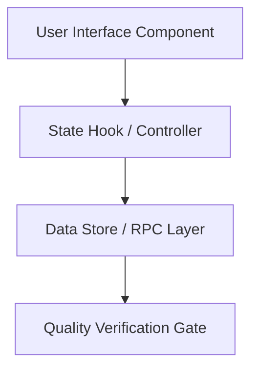

# Feature Plan: [Feature Name]

## 1. Executive Summary
- **Goal:** [One or two sentences describing the desired outcome]
- **Target Persona:** [Who benefits from this feature?]
- **Governing Personas:** [e.g. Winston (Architect), Amelia (Dev), Murat (QA)]

---

## 2. User Stories & Acceptance Criteria
### User Story 1: [Title]
> As a [type of user], I want [an action] so that [a benefit/outcome].

**Acceptance Criteria:**
- [ ] Criterion 1
- [ ] Criterion 2
- [ ] Criterion 3

---

## 3. Architecture & Data Flow
*Include a Mermaid diagram if the feature touches multiple modules or state boundaries.*

### Component Breakdown
| Component / File | Action (New/Modify) | Purpose |
| :--- | :--- | :--- |
| `src/components/...` | Modify | [Description of change] |
| `src/utils/...` | New | [Description of new helper] |

---

## 4. Regression Defense & Edge Cases
- **Theme / Inversion Risk:** [Does this affect light/dark modes? Are base panels updated?]
- **State & Null Boundaries:** [How are empty or loading states handled?]
- **Shell / Environment Constraints:** [Any platform-specific command or async timing risks?]

---

## 5. Step-by-Step Implementation Sequence
1. **Step 1:** [Scaffold types and contracts]
2. **Step 2:** [Author failing test or baseline verification]
3. **Step 3:** [Implement component logic]
4. **Step 4:** [Apply styling and theme tokens]
5. **Step 5:** [Verify test suite, lint, and build]
6. **Step 6:** [Stage atomic conventional commit]

---

## 6. Verification Checklist
- [ ] All unit tests pass with clean process exit
- [ ] Linting returns 0 errors
- [ ] Production build succeeds without warnings
- [ ] Reversible conventional commit recorded
