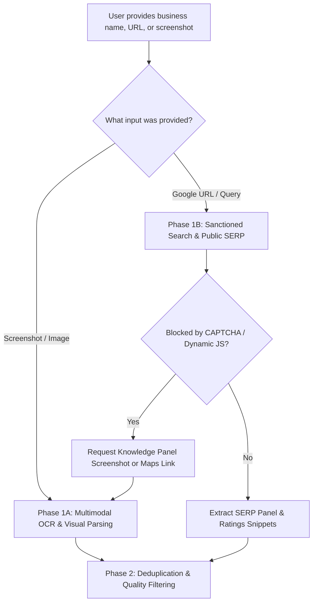

# Google Reviews Scraping & Authentic Verification Runbook

Follow this runbook whenever scraping, parsing, or integrating Google Reviews, Google Maps place data, or Knowledge Panel testimonials for a business, school, or organization.

---

## 🛑 Non-Negotiable Hard-Gate Rules

When an AI agent executes tasks under this skill, the following six production hard-gates must be strictly respected:

1. **Strict Human-in-the-Loop Confirmation**: NEVER write, save, or commit scraped reviews into code, databases, or content registries without presenting the candidate quotes in an alignment interview and receiving explicit user confirmation.
2. **Zero AI / Stock Avatars for Real Reviewers**: NEVER substitute a real human reviewer's avatar with AI-generated portraits or generic stock photography. If an authentic Google profile photo is available, crop and preserve it; otherwise, use an authentic **First-Letter Avatar Fallback** (e.g., "G" for Gomathi, "J" for Janani) matching the brand palette.
3. **Zero Hallucination / Verbatim Integrity**: Quotes must be verbatim from real users. Never summarize, polish grammar, or alter the meaning of a customer's testimonial without explicit user directive. Preserve authentic regional phrases and student/parent context.
4. **No Anti-Bot or CAPTCHA Bypasses**: Never attempt to bypass, automate, or defeat Google CAPTCHAs, Cloudflare checks, or bot detection. If direct HTTP requests fail or are blocked, immediately transition to the hybrid protocol (user-provided screenshot or Google Maps link).
5. **Truncation Flagging (`...More`)**: If a review quote in a screenshot or snippet is truncated with an ellipsis or "More" button, explicitly flag it to the user. Do not invent the missing text.
6. **Comprehensive Trust Metadata**: Always capture the anchor rating (e.g. `4.4 / 5`), total review count (e.g. `60 reviews`), physical address, and a direct Google Maps URL alongside individual review cards.

---

## 🔄 Phase 1: Hybrid Ingestion Protocol

Google Reviews data presents varying levels of accessibility. Agents must navigate through the following tiers:



### 1A. Multimodal Screenshot Parsing
When the user attaches screenshots of the Google Search Knowledge Panel or the Google Reviews modal dialog:
- Extract reviewer name exactly as displayed (e.g. `Suganthi Prabu`).
- Extract star rating count (1 to 5 stars).
- Extract review publication recency (e.g. `3 years ago`, `a year ago`).
- Extract reviewer badges if visible (e.g. `Local Guide`, `4 reviews, 1 photo`).
- Extract attached reviewer photos (e.g. graduation ceremonies, classroom facilities).
- Extract verbatim text.

### 1B. Public Web Search & Maps Query
When given a business name or Google URL:
- Run targeted web search query: `<Business Name> <Location> reviews`.
- Cross-reference with business registry listings (Google Maps URL, Justdial, official website) to confirm exact location, phone number, and hours.

---

## 🔍 Phase 2: Quality Filtering, Milestone Discovery & Avatar Authenticity

Filter candidate reviews into high-value categories:

1. **Avatar Authenticity Protocol**:
   - **Custom Uploaded Photo**: If the reviewer uploaded a custom profile photo (e.g. Suganthi Prabu), crop and save the real image.
   - **Default Google Letter Avatar**: If the reviewer has Google's initial letter badge (e.g. Gomathi's "G", Janani's "J"), do NOT substitute a generic stock face. Set `avatar => ''` and render an authentic letter circle fallback in the brand palette.
   - **Strictly Prohibited**: Never generate or inject AI stock portraits for named real people.
2. **Attached Evidence Photo Ingestion**:
   - Reviewers often attach real photographs to their Google reviews (e.g. auditorium stage banners, graduation robes, competition trophies, science expo booths).
   - Crop and ingest these real photos into the site's media library, correlating them directly with institutional milestone cards or achievement showcases.
3. **Detailed Testimonials**: Highlight reviews with 2+ sentences describing specific curriculum, teachers, atmosphere, or tangible outcomes.
4. **Milestone Extractions**: Look for specific grade completions, awards, or student achievements mentioned by parents (e.g. *"finished Level 2 in 2023"*, *"won Silambam gold"*). Elevate these to institutional milestones/achievements.
5. **Constructive / Mixed Reviews**: Flag any concerns noted by reviewers (e.g., parking, food, schedule) so the user has full situational awareness before publishing.

---

## 🤝 Phase 3: The Mandatory Alignment Interview Gate

Before adding reviews to any theme or database, execute an interactive verification interview with the user.

### Format to Present to the User:

```markdown
### 📋 Candidate Google Reviews Extracted for [Entity Name]
**Overall Rating:** [e.g. 4.4 ★ (60 Google Reviews)]  
**Google Maps Location:** [Address + URL]

| # | Reviewer Name | Rating | Timeframe | Verbatim Quote Excerpt | Key Highlights |
|---|---------------|--------|-----------|------------------------|----------------|
| 1 | **Suganthi Prabu** | ★★★★★ | 3 years ago | "I am mother of Yuvashri who had finished the Level 2 in Kalalayaa at 2023..." | Level 2 Kindergarten Graduate, brilliant process |
| 2 | **Gomathi** | ★★★★★ | 1 year ago | "Kalalaya Nursery School provides a nurturing and engaging environment..." | Caring teachers, balanced play & academics |
| 3 | **N. Janani Priyadharshini** | ★★★★★ | Recent | "I am writing this to share my three years of experience with kalalayaa..." | 3-year parent journey, individualized care |

**Recommended Actions:**
1. Feature all 3 authentic 5-star reviews on the website testimonial carousel with "Verified Google Review" badges.
2. Add a Google Trust Badge (`4.4 ★ on Google (60 Reviews)`) linked to Google Maps.
3. Feature the "Level 2 Kindergarten Graduation" as a campus milestone in the achievements section.
```

The agent must use the `ask_question` tool or an explicit confirmation prompt to allow the user to approve, deselect, or edit the selection.

---

## 💾 Phase 4: Standardized Schema Output

Once approved, format the reviews into standardized schemas.

### 1. JSON Schema (`reviews.json`)
```json
{
  "entity_name": "Kalalayaa Kids Pre School & Fine Arts — Annamalai Nagar",
  "rating_value": 4.4,
  "review_count": 60,
  "google_maps_url": "https://maps.google.com/?q=Kalalayaa+14+Malligai+Salai+2nd+street+Annamalai+Nagar+Tiruchirappalli",
  "reviews": [
    {
      "author": "Suganthi Prabu",
      "rating": 5,
      "date": "2023",
      "role": "Mother of Yuvashri (Level 2 Kindergarten Graduate)",
      "source": "Google Review",
      "avatar": "/assets/photos/avatars/avatar-suganthi-prabu.jpg",
      "quote": "I am mother of Yuvashri who had finished the Level 2 in Kalalayaa at 2023. I would like to thank the organisation who had groomed my kid well in her stepping stage of education. The way of education process is brilliant and best."
    },
    {
      "author": "Gomathi",
      "rating": 5,
      "date": "2025",
      "role": "Parent of Nursery Explorer",
      "source": "Google Review",
      "avatar": "",
      "initial": "G",
      "quote": "Kalalaya Nursery School provides a nurturing and engaging environment for young children. The teachers are caring, the classrooms are well-equipped, and the learning approach balances academics, creativity, and play. Strong communication throughout."
    }
  ]
}
```

### 2. PHP Registry Array (`campus-registry.php`)
```php
'rating'             => '4.4 / 5 (60 reviews)',
'google_reviews_url' => 'https://maps.google.com/?q=Kalalayaa+14+Malligai+Salai+2nd+street+Annamalai+Nagar+Tiruchirappalli',
'testimonials'       => array(
    array(
        'quote'   => 'I am mother of Yuvashri who had finished the Level 2 in Kalalayaa at 2023. I would like to thank the organisation who had groomed my kid well in her stepping stage of education. The way of education process is brilliant and best.',
        'name'    => 'Suganthi Prabu',
        'role'    => 'Mother of Yuvashri (Level 2 Kindergarten Graduate)',
        'stars'   => 5,
        'source'  => 'Google Review',
        'avatar'  => get_theme_file_uri( 'assets/photos/avatars/avatar-suganthi-prabu.jpg' ),
    ),
    array(
        'quote'   => 'Kalalaya Nursery School provides a nurturing and engaging environment for young children...',
        'name'    => 'Gomathi',
        'role'    => 'Parent of Nursery Explorer',
        'stars'   => 5,
        'source'  => 'Google Review',
        'avatar'  => '',
        'initial' => 'G',
    ),
),
```

---

## 🛠️ Phase 5: Verification & Schema Validation

Run the bundled verification script `scripts/validate_reviews.py` to ensure zero empty fields, valid 1-5 ratings, and escaped quotes before landing changes.
